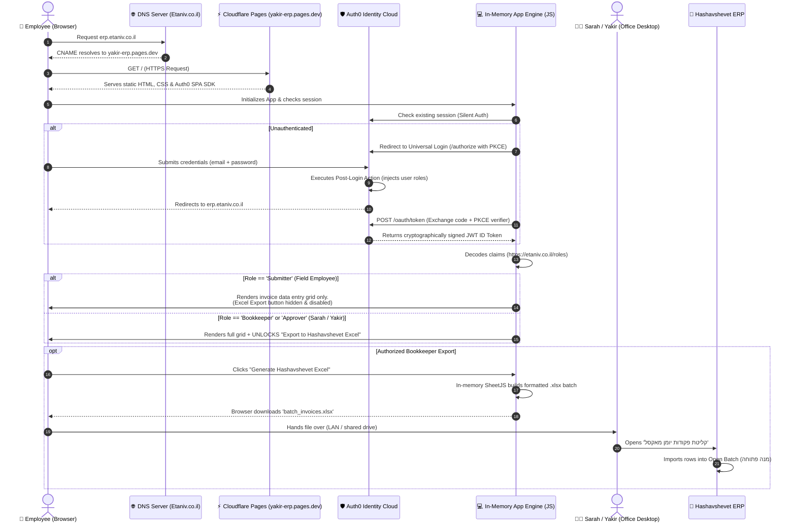

# Auth0 RBAC Integration Guide for Yakir's Web App

This guide explains how **Auth0 (Free Tier)** connects to Yakir's client-side HTML app to provide secure authentication and **Role-Based Access Control (RBAC)** without requiring a backend database.

---

## 1. How Auth0 Works in a Serverless/Static App (SPA Flow)

Because the app is a static client hosted on Cloudflare Pages, it uses Auth0's standard **Single Page Application (SPA)** flow with **PKCE (Proof Key for Code Exchange)**.

### Sequence Diagram: Subdomain Routing, Cloudflare Delivery & Auth0 RBAC Flow



---

## 2. How RBAC is Enforced in This Architecture

In a static, serverless architecture without a custom backend server, access control is enforced through **two layers of defense**:

### Layer 1: Cryptographic JWT Claims & Client-Side UI Gating
1. **Immutable Roles:** When the user logs in, Auth0's server signs an ID token using **RS256 asymmetric encryption**. The user's role (e.g., `Submitter`, `Approver`, `Bookkeeper`) is embedded inside the token payload:
   ```json
   {
     "sub": "auth0|64f1a2b3c4d5e6f",
     "name": "Yossi Cohen",
     "https://etaniv.co.il/roles": ["Submitter"]
   }
   ```
2. **Deterministic UI Rendering:** The client-side application inspects the cryptographically validated claims:
   - For **Submitters:** The button "Export Hashavshevet Batch" is completely excluded from the DOM. Standard employees can only type invoice rows and validate VAT math.
   - For **Approvers / Bookkeepers:** Review controls, account mapping tools, and export triggers are mounted and active.

### Layer 2: Physical & Operational Perimeter (Hashavshevet Defense)
Even if a technically inclined employee attempts to bypass client-side JavaScript (e.g., by modifying DOM elements in Chrome DevTools to unhide the export button):
1. **Local-Only File Generation:** The app runs in the user's browser memory. Bypassing the UI button merely generates an Excel file on the employee's personal device.
2. **Zero Direct ERP Access:** The web app has **no network connection to Hashavshevet**. Hashavshevet runs exclusively on Yakir's physical office PC behind the office firewall.
3. **The Ultimate Gatekeeper:** Only Sarah and Yakir possess Windows login credentials to the office PC and the administrative master password inside Hashavshevet. An unauthorized Excel file can never reach Hashavshevet's ledger without Sarah physically selecting and reviewing it inside the software.

---

## 2. Step 1: Configure Auth0 Dashboard (One-Time Setup)

1. **Create an Application:**
   - In Auth0 Dashboard $\rightarrow$ **Applications** $\rightarrow$ **Create Application**.
   - Name: `Yakir-ERP-Assistant`.
   - Type: **Single Page Web Applications**.
   - Allowed Callback URLs: `https://erp.yakir-company.co.il`, `http://localhost:3000`.
   - Allowed Logout URLs: `https://erp.yakir-company.co.il`, `http://localhost:3000`.
   - Allowed Web Origins: `https://erp.yakir-company.co.il`, `http://localhost:3000`.

2. **Define User Roles in Auth0:**
   - In Dashboard $\rightarrow$ **User Management** $\rightarrow$ **Roles** $\rightarrow$ Click **Create Role**:
     - `Submitter` (מזין חשבוניות - entry only)
     - `Approver` (מנהל מאשר - review & approval)
     - `Bookkeeper` (מנהלת חשבונות / יקיר - full rights & Excel export)

3. **Add Roles to the ID Token (Auth0 Action):**
   - In Dashboard $\rightarrow$ **Actions** $\rightarrow$ **Flows** $\rightarrow$ **Login**.
   - Add a custom Post-Login action script:
     ```javascript
     exports.onExecutePostLogin = async (event, api) => {
       const namespace = 'https://yakir-erp.com';
       if (event.authorization) {
         api.idToken.setCustomClaim(`${namespace}/roles`, event.authorization.roles);
       }
     };
     ```
   - Click **Deploy** and drag the action into the Login pipeline.

4. **Register the 3 Employees:**
   - In Dashboard $\rightarrow$ **User Management** $\rightarrow$ **Users** $\rightarrow$ **Create User** (enter employee emails).
   - Under each user's profile $\rightarrow$ **Roles** tab $\rightarrow$ assign their respective role.

---

## 3. Step 2: Connecting Auth0 to Yakir's HTML App

In Yakir's `index.html`, add the official Auth0 SPA SDK via CDN:

```html
<!-- Include Auth0 SPA SDK -->
<script src="https://cdn.auth0.com/js/auth0-spa-js/2.1/auth0-spa-js.production.js"></script>

<script>
let auth0Client = null;

async function initAuth() {
  auth0Client = await auth0.createAuth0Client({
    domain: "YOUR_AUTH0_DOMAIN.auth0.com",
    clientId: "YOUR_AUTH0_CLIENT_ID",
    authorizationParams: {
      redirect_uri: window.location.origin
    }
  });

  // Handle redirect callback from Auth0 login
  if (location.search.includes("state=") && location.search.includes("code=")) {
    await auth0Client.handleRedirectCallback();
    window.history.replaceState({}, document.title, window.location.pathname);
  }

  const isAuthenticated = await auth0Client.isAuthenticated();

  if (!isAuthenticated) {
    // Show login screen or redirect
    await auth0Client.loginWithRedirect();
    return;
  }

  // Get user details and assigned roles
  const user = await auth0Client.getUser();
  const claims = await auth0Client.getIdTokenClaims();
  const roles = claims["https://yakir-erp.com/roles"] || [];

  renderAppByRole(user, roles);
}

function renderAppByRole(user, roles) {
  document.getElementById("user-name").innerText = `שלום, ${user.name}`;

  const isBookkeeper = roles.includes("Bookkeeper");
  const isApprover = roles.includes("Approver");

  // Dynamic RBAC UI enforcement:
  if (!isBookkeeper) {
    // Hide Hashavshevet Excel Export from standard submitters
    document.getElementById("export-excel-btn").style.display = "none";
  } else {
    document.getElementById("export-excel-btn").style.display = "block";
  }
}

window.addEventListener("load", initAuth);
</script>
```

---

## 4. Key Benefits of This Architecture
1. **Zero Database Needed:** Auth0 stores user credentials and roles securely in the cloud.
2. **Cryptographic Integrity:** Roles are signed in an encrypted JSON Web Token (JWT) that cannot be tampered with on the client.
3. **100% Free Tier:** Auth0 provides up to **7,500 monthly active users (MAU)** for free, covering Yakir's 4 users forever.
