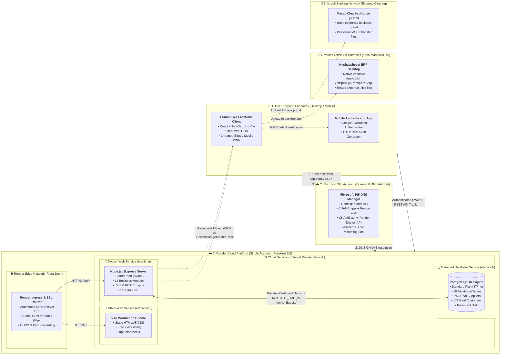
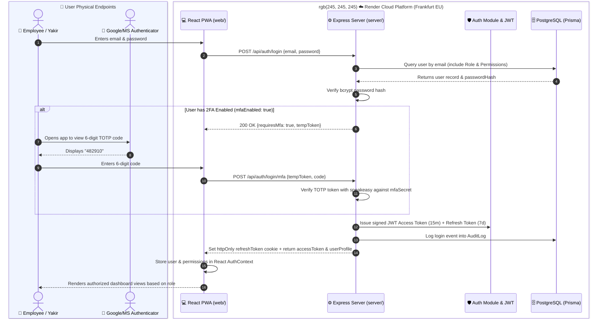
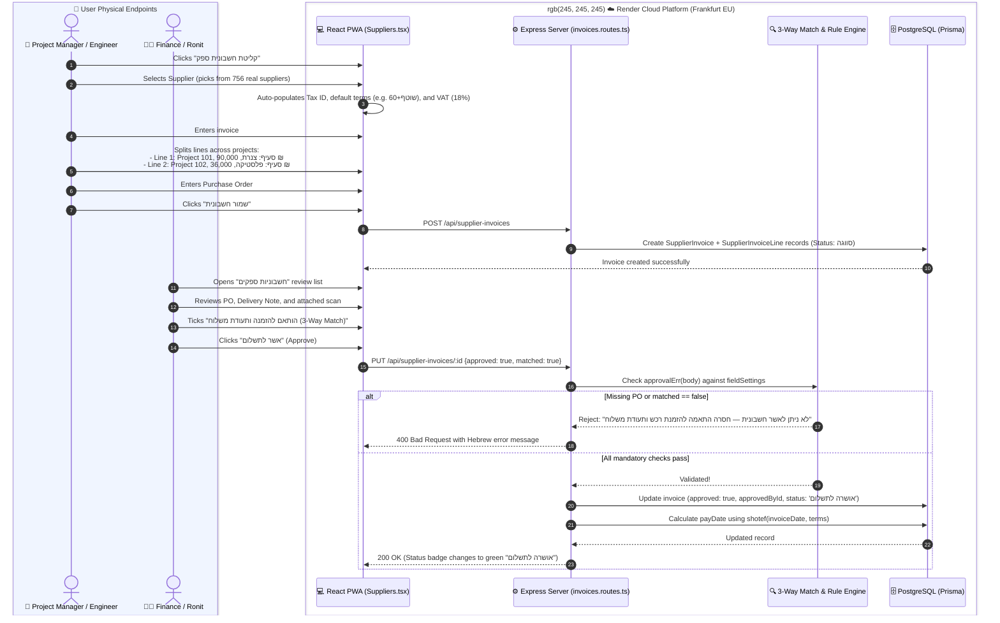
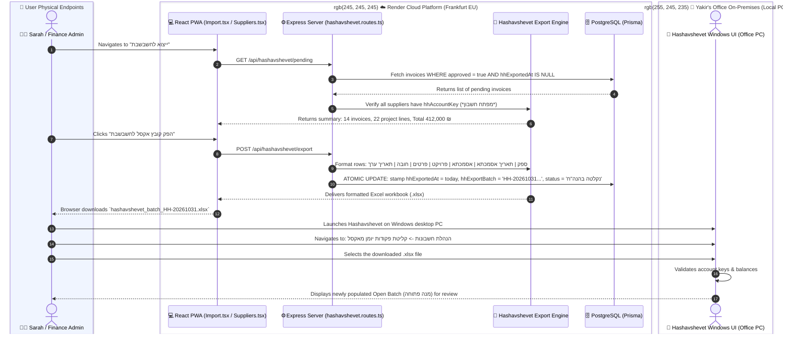
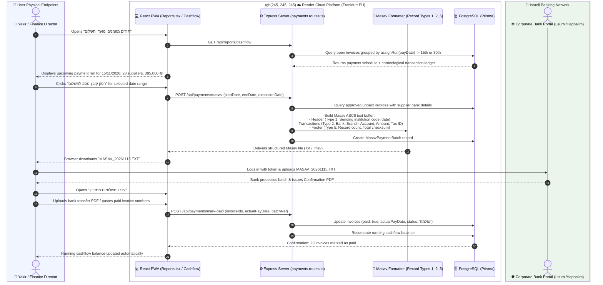
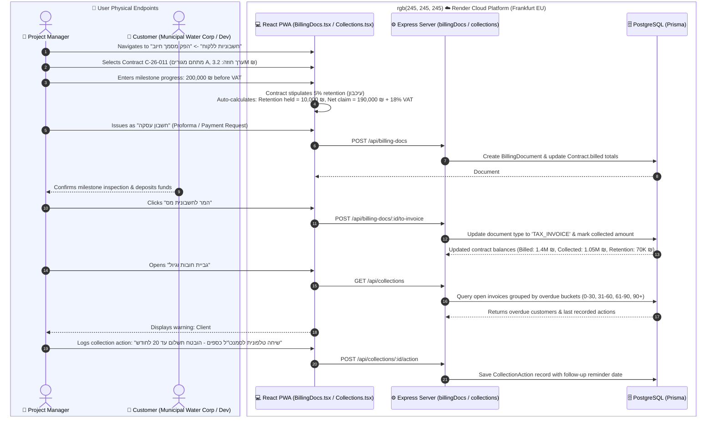
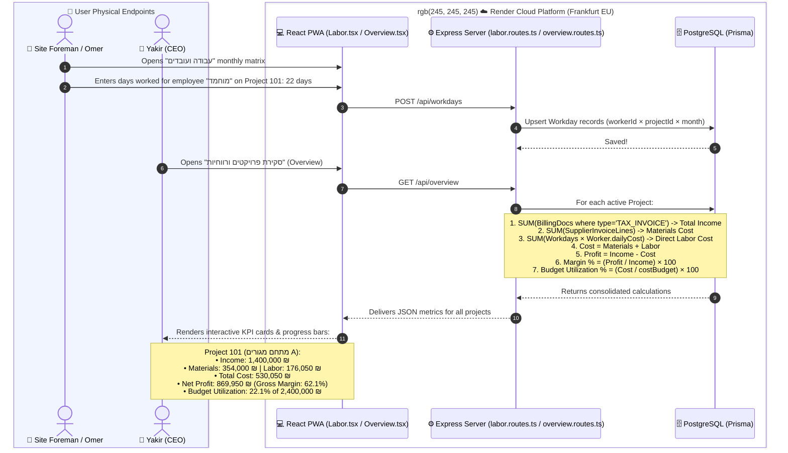

# Etaniv System: Complete POC, Codebase & Roadmap Analysis

> **Quick Reference:** This document analyzes the artifacts provided in `From Yakir/`:
> 1. `אתניב — מערכת ניהול פרויקטלי (תצוגה חיה).html` (Interactive Browser Demo)
> 2. `Etaniv — Go Live Guide.html` (AI Deployment Roadmap for Render.com)
> 3. `etaniv-app_21/` (Complete Production Monorepo: `server/` + `web/` + `render.yaml`)
>
> For full analysis details, see [**docs/etaniv_poc_and_roadmap_analysis.md**](./etaniv_poc_and_roadmap_analysis.md).

---

## 1. Executive Summary: What is the `etaniv-app_21` Code?

The folder `From Yakir/etaniv-app_21` (from `etaniv-app_21.zip`) is the **complete production-grade source code** for **אתניב ב.י בע"מ (Etaniv B.Y. Ltd. — Water & Environmental Technologies)**.

It is structured as a full-stack TypeScript monorepo:
- **`server/` (Backend API):** Node.js + Express + TypeScript + Prisma ORM + PostgreSQL. Includes Dockerfile, JWT auth, TOTP 2FA, and a database seeder (`real-accounts.ts`) with **756 real suppliers** and **172 real customers** from Hashavshevet.
- **`web/` (Frontend PWA):** React + TypeScript + Vite. Hebrew RTL single-page progressive web app containing all 9 operational modules.
- **`render.yaml` (Infrastructure as Code):** Render.com Blueprint provisioning the database (`etaniv-db`), API (`etaniv-api`), and web app (`etaniv-web`).
- **`DEPLOY.md`:** Step-by-step production deployment guide.

---

## 2. Relationship to the Single-File HTML POC

| Aspect | The Single HTML File (`אתניב — ... (תצוגה חיה).html`) | The Source Code Monorepo (`etaniv-app_21`) |
|---|---|---|
| **Nature** | Compiled standalone client demo bundle | Full production source code |
| **Backend & DB** | In-browser mock server (`window.fetch` interceptor) | Real Express REST API + PostgreSQL DB (Prisma ORM) |
| **Authentication** | Simulated static user tokens (`demo`) | Real cryptographic JWTs + TOTP 2FA (Authenticator app) |
| **Purpose** | Immediate zero-install browser testing for Yakir | Production deployment to Render.com and ongoing engineering |

---

## 3. How It Fits Into the Go-Live Plan

`etaniv-app_21` is the exact payload required by **Step 0 & Step 1** of `Etaniv — Go Live Guide.html`:
1. Push `etaniv-app_21` to a private GitHub repository.
2. In Render.com: Click **New → Blueprint** and select the repository.
3. Render automatically provisions:
   - PostgreSQL Database in Frankfurt (`etaniv-db`).
   - Dockerized API container (`etaniv-api`).
   - Globally distributed static PWA (`etaniv-web`).
4. In Render's web shell, execute `node dist/prisma/seed.js` to seed 756 suppliers, 172 customers, roles, and Yakir's admin account.
5. Add DNS CNAMEs for `app.etaniv.co.il` and `api.etaniv.co.il`.
6. Total monthly infrastructure cost: **~$14 / month (~50 ₪/mo)**.

---

---

## 4. Uncovered Real-World Business Workflows

1. **Project Cost Splitting (*תמחיר פרויקטים*):** Invoices are split across specific project codes (`101, 102`) and budget categories (*צנרת, פלסטיקה, חשמל*).
2. **3-Way Matching (*התאמה משולשת*):** Invoices strictly require matching against a Purchase Order (*הזמנת רכש*) and Delivery Note (*תעודת משלוח*) before payment approval.
3. **Israeli Payment Terms (*שוטף פלוס*):** Auto-calculates `payDate` and slots payments into bi-monthly runs (15th & 30th).
4. **Masav Interbank File Generation (*מס"ב*):** Bulk electronic bank transfers directly to supplier bank accounts.
5. **Customer Contracts, Retention (*עיכבון*) & Collections (*גיול חובות*):** Manages project revenue, warranty retentions, and debt aging.

---

## 5. System Architecture Block Diagram (`etaniv-app_21`)

*This diagram illustrates the physical and conceptual topography of the system. All cloud services run within a **single Render account** in the **Frankfurt (EU)** region.*



---

## 6. End-to-End Sequence Diagrams for All App Flows

Below are comprehensive sequence diagrams covering all core business and operational flows implemented in `etaniv-app_21`.

### Flow 1: Authentication, Session Management & Two-Factor Authentication (2FA)

*Software Analogy:* Multi-factor cryptographic identity verification using time-based one-time passwords (TOTP) and signed JWT tokens with refresh rotation.



---

### Flow 2: Supplier Invoice Ingestion, Line Splitting & 3-Way Matching Approval

*Software Analogy:* Transaction ingestion and data validation pipeline enforcing a 3-way checksum (Purchase Order + Delivery Note + Invoice) and splitting costs across project tags before allowing state transition to `APPROVED`.
*Hebrew Accounting Terms:*
- **Supplier Invoice:** *חשבונית מס ספק*
- **Purchase Order (PO):** *הזמנת רכש*
- **Delivery Note:** *תעודת משלוח*
- **Project Cost Center:** *סעיף תקציב / סיווג פרויקט*



---

### Flow 3: Hashavshevet Accounting Export & Batch Synchronization

*Software Analogy:* Atomic batch extraction and format compilation into an Excel spreadsheet, tagging exported records to prevent duplicate submissions (*מניעת כפילות*), ready for consumption by Hashavshevet's staging buffer (*מנה פתוחה*).
*Hebrew Accounting Terms:*
- **Open Batch:** *מנה פתוחה*
- **Account Key in Hashavshevet:** *מפתח חשבון בחשבשבת*
- **Value Date / Payment Due Date:** *תאריך ערך*



---

### Flow 4: Payment Run Scheduling, Masav Bank File Generation & Reconciliation

*Software Analogy:* Automated scheduling into semi-monthly batch payout runs (15th and 30th) and compiling electronic fund transfer files for the Israeli interbank clearing house (*מס"ב*), followed by PDF payout reconciliation.
*Hebrew Accounting Terms:*
- **Masav:** *מס"ב (מרכז סליקה בנקאי)*
- **Payment Run:** *סבב תשלומים (15 ו-30 לחודש)*
- **Cash Flow Ledger:** *תזרים מזומנים כרונולוגי*



---

### Flow 5: Customer Contracts, Progressive Billing, Retention & Collections

*Software Analogy:* Managing incoming accounts receivable (revenue contracts) with milestone billing, warranty escrow tracking (*עיכבון*), and time-bucketed debt aging (*גיול חובות*).
*Hebrew Accounting Terms:*
- **Customer Contract:** *חוזה לקוח*
- **Warranty Retention:** *עיכבון (5%-10% המוחזקים עד תום תקופת הבדק)*
- **Debt Aging:** *גיול חובות (שוטף, 30+, 60+, 90+ יום פיגור)*
- **Transaction Invoice / Proforma:** *חשבון עסקה*



---

### Flow 6: Labor Tracking & Real-Time Project Profitability Dashboard

*Software Analogy:* Aggregating internal resource metrics (worker hourly/daily cost matrix) and external direct costs (materials) against customer contract revenue to compute real-time gross profit margins.
*Hebrew Accounting Terms:*
- **Project Profitability:** *רווחיות פרויקטלית*
- **Budget Utilization:** *ניצול תקציב עלויות*
- **Daily Work Log:** *יומן עבודה יומי / ימי עבודה*



---

## 6. Database Schema & Tables Specification (PostgreSQL / Prisma)

The database schema (`server/prisma/schema.prisma`) comprises **18 relational tables** and **2 enums**, architected around project-centric cost accounting (*תמחיר פרויקטים*). Every financial transaction (supplier expense, labor day, billing doc) connects back to a `Project` for real-time profitability tracking.

### Entity Relationship & Table Summary

| # | Table / Model | Hebrew Accounting Concept | Description & Key Attributes |
|---|---|---|---|
| **1** | `User` | *משתמש מערכת* | System accounts, bcrypt salted password hash (`passwordHash`), status (`UserStatus`), TOTP 2FA secret (`mfaSecret`), and role relation. |
| **2** | `Role` | *תפקיד והרשאה* | Role definitions (`admin`, `finance`, `pm`, `viewer`). |
| **3** | `Permission` | *מטריצת הרשאות* | Granular read/write/delete permissions per navigation menu (`canView`, `canWrite`, `canDelete`). |
| **4** | `Project` | *פרויקט (תמחיר)* | Core job entity with code, name, and total cost budget (`costBudget` Decimal(14,2)). Parent of all revenues and expenses. |
| **5** | `ExpenseType` | *סעיף תקציבי / הוצאה* | Standard expense categories (e.g., חומרים, קבלני משנה, ציוד, הובלות). |
| **6** | `Supplier` | *כרטיס ספק* | Vendor directory (756 real accounts), tax ID (*ח.פ/ע.מ*), Hashavshevet account key (*מפתח חשבון*), VAT rate, payment terms (*שוטף+*), and bank routing for Masav. |
| **7** | `SupplierInvoice` | *חשבונית מס ספק* | Ingested vendor bills with amounts, VAT, 3-way match reconciliation flags (`matched`, `purchaseOrderNo`, `deliveryNoteNo`), Hashavshevet export batch tracking (`hhExportBatch`), and payment status. |
| **8** | `InvoiceLine` | *פיצול שורות לחשבונית* | Multi-project allocation lines splitting a single invoice across multiple projects and expense types. |
| **9** | `Customer` | *כרטיס לקוח* | Client directory (172 real accounts) with contact info, email, phone, and tax registration. |
| **10** | `Contract` | *חוזה לקוח* | Revenue contracts linking a customer to a project, total contract value, payment terms, and warranty retention percentage (*עיכבון*). |
| **11** | `BillingDoc` | *מסמך חיוב ללקוח* | Progressive billing documents issued to clients (`DocType`: חשבון עסקה, חשבונית מס, חשבונית מס-קבלה), tracking retention withheld and aging. |
| **12** | `BillingOffset` | *קיזוזים מתשלום* | Deductions and penalty offsets applied to client billing documents (*קיזוזים מוסכמים*). |
| **13** | `CollectionAction` | *פעולת גבייה וגיול* | Collection event logs (phone call, email, legal letter) with follow-up reminder timestamps. |
| **14** | `Worker` | *עובד / פועל* | Direct labor directory with daily employer cost (*עלות שכר מעביד יומית*). |
| **15** | `Workday` | *יומן ימי עבודה* | Monthly allocated days worked per worker per project. Unique constraint on `[workerId, projectId, month]`. |
| **16** | `FileAsset` | *קובץ ומסמך סרוק* | Scanned invoice PDFs, delivery slips, and contracts with storage key and virus-scan status (`scanned`, `scanResult`). |
| **17** | `InvoiceFieldSetting` | *הגדרות שדות חובה* | Configurable mandatory validation rules for approving supplier invoices (e.g., whether PO or delivery note is mandatory). |
| **18** | `OrgSetting` | *הגדרות חברה ומס"ב* | Singleton system settings: Masav sender code (*קוד מוסד שולח*), company legal name, and cash flow opening balance (*יתרת פתיחה*). |
| **19** | `AuditLog` | *יומן ביקורת אירועים* | Immutable security and compliance log recording user ID, action (`LOGIN`, `CREATE`, `EXPORT`, etc.), entity, IP address, and payload. |

---

### Database Enums

- **`UserStatus`**: `PENDING` (awaiting admin approval) | `APPROVED` (active) | `DISABLED` (deactivated).
- **`DocType`**: `ESEK` (*חשבון עסקה* / Proforma) | `TAX` (*חשבונית מס* / Tax Invoice) | `TAX_RECEIPT` (*חשבונית מס-קבלה* / Tax Invoice & Receipt).

---

## 7. Current Infrastructure, Web Hosting & DNS Management (`etaniv.co.il`)

Analysis of Yakir's deployment documentation combined with live technical network verification reveals the current production domain infrastructure:

### 1. DNS Authority & Management
- **Nameservers:**
  - `ns1.bdm.microsoftonline.com`
  - `ns2.bdm.microsoftonline.com`
  - `ns3.bdm.microsoftonline.com`
  - `ns4.bdm.microsoftonline.com`
- **DNS Host / Management Console:** **Microsoft 365 / Azure DNS (Business Domain Management)**.
- **Operational Reality:** Yakir manages his DNS records directly inside the **Microsoft 365 Admin Center** (tied to the corporate Microsoft 365 / Exchange email accounts such as `yakir@etaniv.co.il`).

### 2. Current Website Hosting
- **Apex & WWW Records:** `etaniv.co.il` / `www.etaniv.co.il` resolves to IP `212.199.178.4` (AS12400 Partner Communications, Petah Tikva, Israel; host `server1.abrahamson.co.il`).
- **Web Stack:** Linux server running **Nginx** reverse proxy and **WordPress** with a custom Elementor theme.

### 3. Subdomain Configuration for Render Deployment
Per `DEPLOY.md` and `Etaniv — Go Live Guide.html`, setting up the ERP system does **not** interrupt or affect the existing WordPress marketing site:
1. Yakir logs into **Microsoft 365 Admin Center** → **Settings** → **Domains** → `etaniv.co.il` → **DNS Records**.
2. Adds two new `CNAME` records:
   - `app` → Render Static Site address (pointing to `etaniv-web.onrender.com`).
   - `api` → Render Web Service address (pointing to `etaniv-api.onrender.com`).
3. Render automatically issues and renews Let's Encrypt SSL/TLS certificates for both subdomains.

---

## 8. Real-World Architecture Context: How the Current Setup Came to Be

For developers unfamiliar with corporate domain and email administration, here is the real-world sequence of how Yakir's current infrastructure was configured:

```
[ Domain Registrar (e.g., LiveDNS / Box) ]
                     │  (Delegates NS authority)
                     ▼
[ Microsoft 365 / Azure DNS (ns1-4.bdm.microsoftonline.com) ]
        │                                         │
        │ MX, SPF, DKIM, Teams                    │ A Record (etaniv.co.il / www)
        ▼                                         ▼
[ Exchange Online (@etaniv.co.il) ]    [ Israeli VPS (212.199.178.4) ]
                                       [ Nginx + Self-Hosted WordPress ]
```

1. **Domain Registration:**
   Yakir registered the primary domain `etaniv.co.il` via an accredited Israeli domain registrar (e.g., LiveDNS, Box, SPD).
2. **Corporate Email Setup (The Microsoft 365 Step):**
   When setting up corporate Microsoft 365 for business email (`yakir@etaniv.co.il`), Microsoft's onboarding wizard gives two options:
   - *Option A (Automated DNS Delegation):* Point domain nameservers to Microsoft (`ns1-4.bdm.microsoftonline.com`).
   - *Option B (Manual DNS Records):* Keep external DNS and manually insert over 10 MX, SPF, DKIM, and autodiscover records.
   Yakir (or his IT support) chose Option A so Microsoft handles all Exchange email routing and security records automatically.
3. **Self-Hosted WordPress Website:**
   Unlike `WordPress.com` (a closed SaaS platform), Yakir uses **self-hosted WordPress (`WordPress.org`)**, built with Elementor. A web development agency deployed this site onto an independent Linux server in Petah Tikva (`212.199.178.4`, Partner Communications).
4. **Linking Website to Domain:**
   Inside the **Microsoft 365 Admin Center**, an `A` record was added pointing `etaniv.co.il` and `www.etaniv.co.il` to `212.199.178.4`.
5. **Key Takeaway for Etaniv ERP Assistant:**
   - Email and DNS are centrally anchored in Microsoft 365.
   - The WordPress marketing site is isolated on an external server.
   - Creating new subdomains (`app.etaniv.co.il`, `api.etaniv.co.il`) in Microsoft 365 for Render poses **zero risk** of downtime or disruption to either corporate email or the live WordPress website.

---

## 9. Open Issues, Architectural Gaps & Production Vulnerabilities

This section documents critical functional, technical, and regulatory gaps identified in the current `etaniv-app_21` design and implementation that require resolution before or immediately following production go-live:

### 1. Technical & Cloud Infrastructure Gaps

| # | Gap / Vulnerability | Root Cause in Code / Architecture | Production Impact & Risk | Required Resolution |
|---|---|---|---|---|
| **T-1** | **Ephemeral Docker Storage & File Loss** | `FileAsset` model exists in `schema.prisma`, but actual file upload endpoints are unimplemented in Express (`server/src/modules/`). The Docker container filesystem is strictly ephemeral. | If files are uploaded to the local container disk, they are permanently destroyed on every deployment, restart, or container crash. | Connect upload ingestion directly to an external object store (e.g., **Cloudflare R2** / **AWS S3**) via pre-signed URLs, or attach a Render Persistent Disk. |
| **T-2** | **Disaster Recovery & 7-Year Accounting Retention** | Render's managed PostgreSQL automated daily snapshots have a rolling **7-day retention window**. Free tier databases expire and delete after 30 days. | Israeli Tax Ordinance (*הוראות ניהול ספרים*) legally mandates preserving accounting records for at least **7 years**. If catastrophic corruption or silent deletion exceeds 7 days, data is unrecoverable. | Implement an automated daily/weekly cron task running `pg_dump`, encrypting the archive, and streaming it to immutable cold storage (e.g., AWS S3 Glacier / Cloudflare R2). |
| **T-3** | **Observability, APM & Error Alerting** | Errors log only to `stdout` via `pino-http` and `console.error(err)` in `middleware/error.ts`. Audit logging failures in `audit.ts` fail silently. | Production errors require manually checking Render log streams. No proactive notifications (Slack, email, SMS) alert Yakir or developers when API endpoints fail or database connections drop. | Integrate an error monitoring service (e.g., **Sentry**) and configure uptime alerting on `/api/health`. |
| **T-4** | **Unimplemented Automated AI / OCR Extraction** | `etaniv-app_21` currently relies on manual employee data entry for vendor invoices, line splitting, and tax amounts. | The original goal—drastically reducing the time 3 employees spend manually typing invoices—is only partially solved. Manual data entry remains a operational bottleneck. | Implement the multimodal AI extraction pipeline (Hebrew OCR + Vision LLM) to auto-populate invoice fields, perform Luhn checksums, and auto-split VAT. |

---

### 2. Israeli Accounting & Regulatory Compliance Gaps

| # | Gap / Vulnerability | Regulatory Requirement (*חקיקה ותקינה*) | Production Impact & Risk | Required Resolution |
|---|---|---|---|---|
| **A-1** | **Missing Israel Invoicing Clearance (*חוק החשבוניות / מספר הקצאה*)** | Invoices exceeding statutory thresholds (25,000 ₪ in 2024, descending toward 5,000 ₪) require real-time Israel Tax Authority clearance numbers (*מספר הקצאה*). | Without a valid Tax Authority allocation number, Etaniv is **legally barred from deducting Input VAT (*מע"מ תשומות*)**, risking heavy tax authority penalties. | Integrate with the Israel Tax Authority B2B Allocation REST API to validate supplier allocation numbers before invoice approval. |
| **A-2** | **Withholding Tax Verification (*ניכוי מס במקור ואישור ניהול ספרים*)** | Israeli law mandates withholding tax at source from supplier payments unless the supplier possesses a valid exemption certificate (*אישור ניכוי מס במקור*). | Generating bulk bank payouts via Masav without verifying withholding rates creates legal tax liability for Etaniv to pay the withheld tax out-of-pocket. | Connect supplier tax verification to the SHAAM (*שע"ם*) B2B web service to dynamically check and apply current withholding tax percentages. |
| **A-3** | **One-Way Asynchronous Sync with Hashavshevet** | System exports an Excel batch (`.xlsx`) to Hashavshevet's open batch (*מנה פתוחה*), but has no reverse synchronization. | If the bookkeeper modifies, reclassifies, or rejects an invoice inside Hashavshevet desktop, `etaniv-app_21` remains unaware and presents stale or contradictory figures. | Establish a reconciliation import process (or periodic batch status sync) so Hashavshevet transaction statuses reflect back into Etaniv. |
| **A-4** | **Manual Bank Statement Reconciliation (*התאמות בנקים*)** | Electronic payouts are pushed via Masav, but reconciling bank statements back against approved invoices is completely manual. | Reconciling cash flow and verifying whether cheques, direct debits, or transfers actually cleared requires manual human audit. | Add a bank statement parser (supporting Israeli bank Excel / OFX formats) to automate ledger matching (*התאמת תנועות בנק*). |


