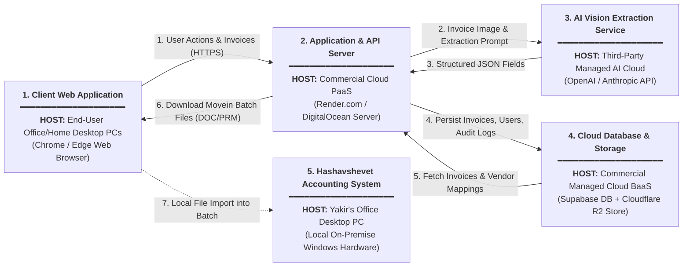
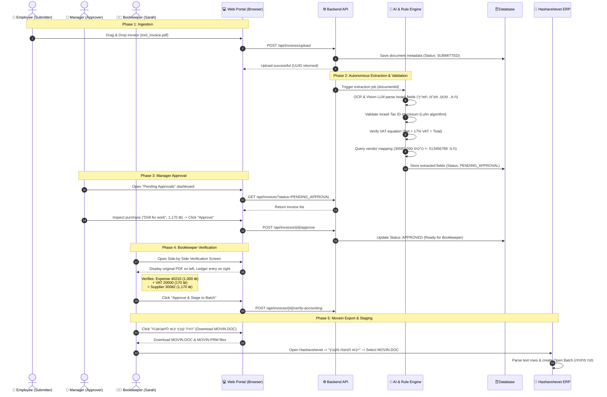

# Early System Design, Architecture & Operations Archive

> **Archive Notice:**  
> This master document consolidates our early engineering explorations, functional requirements, operational workflows, and initial infrastructure designs developed **before** receiving Yakir's production codebase (`etaniv-app_21`).  
> It serves as a historical and comparative baseline between our initial expectations and Yakir's actual implementation.  
> For the active, production-grade system specification, see [**docs/etaniv.md**](./etaniv.md).

---

## Table of Contents

1. [Executive Summary & Problem Definition](#1-executive-summary--problem-definition)
2. [Accounting Domain Foundations for the Developer](#2-accounting-domain-foundations-for-the-developer)
3. [Israeli Business Document Taxonomy & Handling](#3-israeli-business-document-taxonomy--handling)
4. [Hashavshevet (חשבשבת ERP) Deep Dive & Integration Modes](#4-hashavshevet-חשבשבת-erp-deep-dive--integration-modes)
5. [Competitive Landscape & Market Analysis](#5-competitive-landscape--market-analysis)
6. [Initial User Roles, Access & Authorization (RBAC)](#6-initial-user-roles-access--authorization-rbac)
7. [System Architecture Diagrams & Component Breakdown](#7-system-architecture-diagrams--component-breakdown)
   - [Diagram 1: High-Level Components & Hosting Platforms](#diagram-1-high-level-components--hosting-platforms-left-to-right)
   - [Diagram 2: Inside Look into Components & Responsibilities](#diagram-2-inside-look-into-components--sub-component-breakdown-left-to-right)
   - [Component Alignment Matrix](#component-alignment--traceability-matrix)
8. [End-to-End Invoice Life Cycle Sequence Flow](#8-end-to-end-invoice-life-cycle-sequence-flow)
9. [Detailed User & System Workflow: Buying Work Tools (Step-by-Step)](#9-detailed-user--system-workflow-buying-work-tools-step-by-step)
10. [Yakir's Operational Reality & Manual Business Routines](#10-yakirs-operational-reality--manual-business-routines)
11. [Target User Experience: Frictionless Digital Transition](#11-target-user-experience-frictionless-digital-transition)
12. [Cloud Platform Accounts & Infrastructure Cost Breakdown](#12-cloud-platform-accounts--infrastructure-cost-breakdown)
13. [Office Hardware & Physical Assets](#13-office-hardware--physical-assets)
14. [Future Enhancements & Technical Roadmap](#14-future-enhancements--technical-roadmap)

---

## 1. Executive Summary & Problem Definition

Currently, the business owner (**Yakir**) and three employees spend substantial manual effort taking supplier invoices, reading amounts and line items, classifying expense categories, and manually typing them into **Hashavshevet (חשבשבת ERP)**.

### The Objective
Build a modern, secure, online web platform that:
1. Allows employees and Yakir to upload invoices (PDFs, scanned receipts, image files, email attachments) through a web browser.
2. Uses Multimodal AI / OCR tailored to the **Israeli market** to extract all key financial metadata.
3. Automatically maps vendors, VAT accounts, and expense categories.
4. Provides a multi-role approval workflow (RBAC) where employees upload, managers approve, and bookkeepers verify.
5. Injects the resulting balanced transactions (**פקודות יומן**) directly into Hashavshevet through an automated pipeline.

[Back to Top / Table of Contents](#table-of-contents)

---

## 2. Accounting Domain Foundations for the Developer

Before looking at the technical architecture, let's understand the core business concept in plain software engineering terms:

### What is a "Tax-Deductible Expense" (הוצאה מוכרת למס)?
- **Software Analogy:** Think of the company's taxable profit as `NetProfit = TotalRevenue - TaxDeductibleExpenses`.
- If Yakir earns 100,000 ₪ in revenue and buys a work drill for 1,000 ₪ (excluding VAT), that 1,000 ₪ is deducted from his taxable profit. Corporate income tax (*מס חברות*) is calculated on 99,000 ₪ instead of 100,000 ₪.
- **Rules of Recognition:** Under Israeli Income Tax Ordinance (*פקודת מס הכנסה, סעיף 17*), an expense is only deductible if incurred **solely and completely for producing business income**. Buying a power tool for client jobs qualifies; buying personal gifts does not.

### The VAT Separation Mechanism (הפרדת מע"מ תשומות):
When Yakir buys the tool for **1,170 ₪ total**:
1. **Net Expense (1,000 ₪):** Goes to Expense Account (*חשבון הוצאה מוכרת* `40210 - כלי עבודה`). Reduces company taxable profit.
2. **Input VAT (170 ₪ - מע"מ תשומות):** Goes to Asset Account (*מע"מ תשומות* `20000`). This is a **direct credit/rebate** from the government. At the end of the month, Yakir subtracts this 170 ₪ from the VAT he collected from his own customers.
3. **Supplier Debt (1,170 ₪):** Goes to Supplier Liability Account (*כרטיס ספק* `30082 - טכנו כלים בע"מ`). The company records that it owes 1,170 ₪ to the hardware store until paid.

[Back to Top / Table of Contents](#table-of-contents)

---

## 3. Israeli Business Document Taxonomy & Handling

In Israeli business operations, an Accounts Payable (AP) automation tool must handle more than just single standard tax invoices:

| Document Type (סוג מסמך) | Accounting Purpose | How our System Handles It |
|---|---|---|
| **Tax Invoice (חשבונית מס ספק)** | Formal demand for payment from a registered business. Creates the debt to the supplier and the right to claim Input VAT (**מע"מ תשומות**). | **Primary flow:** Extracts Vendor ID (ח.פ.), Invoice #, Date, Pre-VAT Amount, VAT (17%), Total, and Allocation # (**מספר הקצאה**). Generates a balanced Journal Entry (**פקודת יומן מאוזנת**). |
| **Tax Invoice / Receipt (חשבונית מס קבלה)** | Invoice issued when payment was executed immediately (e.g., paid by credit card, cash, or instant bank wire). | Automatically generates **two steps**: (1) The expense and VAT credit, and (2) The immediate payment settlement against the bank/credit card account. |
| **Receipt / Payment Confirmation (קבלה / אישור העברה)** | Proof of money transferred (bank wire, Bit, credit card slip, check). | Links to existing pending invoices to mark them as paid / settled (**התאמת כרטיס ספק**). |
| **Credit Invoice (חשבונית זיכוי ספק)** | Issued when goods are returned, services cancelled, or a discount was retroactively applied. | Creates an inverted journal entry (reduces supplier debt and reduces claimed VAT). |
| **Delivery Note (תעודת משלוח ספק)** | Proof of physical goods arriving at Yakir's warehouse/office before the monthly invoice arrives. | Stored in system for **Matching**: When the consolidated monthly invoice (**חשבונית מרכזת**) arrives, the system verifies invoice quantities against delivery notes. |
| **Petty Cash & Fuel Slips (קבלות קופה קטנה / דלק / חניה)** | Small receipts paid out-of-pocket by employees needing reimbursement. | Employee uploads via web portal; system classifies under Employee Reimbursement (**חו"ז עובדים**) and specific expense codes. |
| **Allocation Number (מספר הקצאה - מודל חשבוניות ישראל)** | Regulatory requirement by the Israel Tax Authority for B2B invoices above legal thresholds. | OCR verifies presence of the 9-digit/UUID allocation number. Flags invoices lacking an allocation number to prevent illegal VAT deductions. |

[Back to Top / Table of Contents](#table-of-contents)

---

## 4. Hashavshevet (חשבשבת ERP) Deep Dive & Integration Modes

### What is Hashavshevet?
Hashavshevet is the longest-standing Israeli ERP and accounting package (over 40 years in market, developed by Hashavshevet / Wizcount, now part of Hilan Group). It is widely used by Israeli SMBs and mid-market enterprises.

### Deployment Topologies
1. **On-Premise (Most Common for SMBs):** Runs on a local Windows Server or desktop PC, backed by Microsoft SQL Server (or older c-tree). Clients run a legacy Windows desktop UI.
2. **Hashavshevet Cloud (חשבשבת ענן):** Hosted Windows Virtual Desktop / Web ERP running on Hilan's cloud infrastructure.

### How Data Gets Injected (Integration Options)
Accountants adhere to strict audit rules: **never write raw records directly into permanent ledger tables** without passing Hashavshevet's internal balance and audit validation!

1. **Primary Integration Method: Movein Batch Files (`MOVIN.DOC` & `MOVIN.PRM`)**
   - **Native & Universal:** Built into **100% of Hashavshevet installations** since 1995.
   - **Zero Setup & Zero Cost:** Requires no expensive H-Connect license modules from Hilan and no technician visits.
   - **Workflow:** The system formats verified invoices into `MOVIN.DOC` (data lines) and `MOVIN.PRM` (schema parameters). Sarah clicks *"הורד קובץ"* on the web portal, opens Hashavshevet, and clicks *"ייבוא פקודות יומן מקובץ"*.
   - **Lands in an Open Batch (מנה פתוחה):** Staged safely for final review and posting.

2. **Future Upgrade Path: H-Connect REST API Middleware**
   - Hashavshevet's official REST API gateway (`movein` plugin).
   - Once Yakir validates the core system and wants to eliminate the 1-click file download, he can purchase the H-Connect module from Hashavshevet to enable direct HTTP JSON transmission.
   - Kept on the product roadmap alongside a native mobile app as future enhancements.

3. **The "Open Batch" (מנה פתוחה) Invariant:**
   - In both methods, records strictly land in an **Open Batch (מנה זמנית / פתוחה)** rather than being directly committed to the permanent ledger (**קליטת יומן קבועה**).
   - This gives Sarah and Yakir 100% audit confidence before final posting.

[Back to Top / Table of Contents](#table-of-contents)

---

## 5. Competitive Landscape & Market Analysis

### A. Major ERP & Accounting Systems in Israel

| System | Target Audience | Native Cloud? | Native Invoice OCR? | Integration Difficulty |
|---|---|---|---|---|
| **Hashavshevet (חשבשבת)** | SMBs, industrial, retail, wholesale | Hybrid (mostly On-Prem, growing Cloud) | Very limited / relies on 3rd-party add-ons | Medium (via H-Connect or Movein) |
| **Priority ERP (פריוריטי)** | Mid to large enterprises, high-tech | Yes (Priority Cloud / Web) | Has "Priority Scan & Capture" / OCR add-on | High / Powerful REST & OData APIs |
| **SAP Business One (סאפ)** | Mid-market enterprises | Hybrid | Integrates with SAP Concur / DOKKA | Enterprise REST / Service Layer |
| **Rivhit (רווחית)** | Small businesses, retail shops | Desktop & Cloud (Rivhit Online) | Limited / 3rd party OCR | Simple REST API |
| **Morning (חשבונית ירוקה)** | Freelancers, startups, micro-businesses | 100% Cloud SaaS | Has mobile expense scanning for receipts | Great modern REST API |
| **iCount** | Micro & small businesses | 100% Cloud SaaS | Basic mobile receipt upload | REST API |
| **Intuit QuickBooks** | Global SMBs (US / Europe leader) | 100% Cloud SaaS | Built-in receipt capture & bank feed | **Not certified in Israel:** Lacks Israeli Tax Authority approval, no support for PCN874 VAT reports, Form 856 withholding tax, or the Invoicing Law allocation API. |

### B. Third-Party Invoice Automation Tools (What Yakir's system will imitate & surpass)

1. **DOKKA (דוקה):**
   - *The Israeli market benchmark for AP automation.*
   - Connects to Hashavshevet and Priority.
   - Features: Web portal + mobile app, Hebrew OCR with machine learning, automatic extraction of amounts, VAT, Israeli company ID (ח.פ.), and creates batches in Hashavshevet.
   - *Drawback:* Expensive per-document licensing, complex configuration for small companies.
2. **Bisan / AutoDoc / Dext (Receipt Bank):**
   - Tools focused on bookkeepers receiving scanned documents and converting them to Movein / BKMVDATA files.
3. **Why build a custom system for Yakir?**
   - Tailored specifically to his company's 3-employee workflow.
   - Custom approval chains suited to his business hierarchy.
   - Direct integration with his specific Hashavshevet setup without recurring expensive per-page subscription fees.
   - Can incorporate AI (LLM-based reasoning) that learns his specific supplier catalog and expense accounts with higher accuracy than legacy OCR templates.

[Back to Top / Table of Contents](#table-of-contents)

---

## 6. Initial User Roles, Access & Authorization (RBAC)

To solve Yakir's operational bottleneck (currently involving 3 employees with overlapping, manual work), the initial design proposed a fine-grained **Role-Based Access Control (RBAC)** model:

```
+--------------------------------------------------------------------------+
|                        ROLES & PERMISSIONS MATRIX                        |
+-------------------+-----------------+----------------+-------------------+
| Role              | Intended Users  | Capabilities   | Restrictions      |
+-------------------+-----------------+----------------+-------------------+
| 1. Submitter      | Field Workers,  | • Upload files | • Cannot see      |
|    (מעלה מסמכים)  | Secretaries,    | • View own     |   company profits |
|                   | Employees       |   submissions  | • Cannot push     |
|                   |                 | • Edit basic   |   to Hashavshevet |
|                   |                 |   notes        |                   |
+-------------------+-----------------+----------------+-------------------+
| 2. Approver       | Department      | • Review line  | • Cannot change   |
|    (מאשר הוצאה)   | Managers,       |   items/PO     |   accounting chart|
|                   | Operations Lead | • Approve or   |   of accounts     |
|                   |                 |   reject items |                   |
+-------------------+-----------------+----------------+-------------------+
| 3. Bookkeeper     | In-house or     | • Verify VAT   | • System config   |
|    (מנהל/ת חשבונות)| External CPA    | • Map accounts |   managed by Admin|
|                   | (רואה חשבון)    | • Generate &   |                   |
|                   |                 |   export batch |                   |
|                   |                 |   to Hashavshevet              |
+-------------------+-----------------+----------------+-------------------+
| 4. Admin / Owner  | Yakir           | • Full access  | • None            |
|    (מנהל מערכת)   |                 | • User mgmt    |                   |
|                   |                 | • Audit logs   |                   |
|                   |                 | • ERP config   |                   |
+-------------------+-----------------+----------------+-------------------+
```

[Back to Top / Table of Contents](#table-of-contents)

---

## 7. System Architecture Diagrams & Component Breakdown

To provide complete architectural clarity without vertical scrolling, the system architecture was structured into two horizontal Left-to-Right (`graph LR`) diagrams:

### Diagram 1: High-Level Components & Hosting Platforms (Left to Right)

*This diagram contains **no internal sub-blocks**. Each block represents a major system component and explicitly states its hosting platform and physical/cloud environment.*



---

### Diagram 2: Inside Look into Components & Sub-Component Breakdown (Left to Right)

*This diagram contains **5 distinct levels**, one for each component from Diagram 1. There are **no relations/edges between the big components** (as those relationships are already defined in Diagram 1). Each level breaks down its parent component horizontally into its internal sub-components and responsibilities.*

```mermaid
graph LR
    %% Level 1: Client Web Application
    subgraph LEVEL_1 ["Level 1: Component 1 — Client Web Application (User Browser)"]
        direction LR
        C1_PARENT["<b>1. Client Web Application</b><br/>━━━━━━━━━━━━━━━━━━━━<br/>Host: User Desktop PCs"]
        C1_A["<b>Upload & Ingestion UI</b><br/>• Drag-and-drop PDF & images<br/>• Client-side format validation"]
        C1_B["<b>Manager Approval Portal</b><br/>• Single & bulk expense approvals<br/>• Rejection notes & status tracking"]
        C1_C["<b>Bookkeeper Review Studio</b><br/>• Split-screen PDF vs. extracted fields<br/>• 1-click Movein batch download"]
        C1_PARENT --> C1_A
        C1_PARENT --> C1_B
        C1_PARENT --> C1_C
    end

    %% Level 2: Application & API Server
    subgraph LEVEL_2 ["Level 2: Component 2 — Application & API Server (Commercial PaaS)"]
        direction LR
        C2_PARENT["<b>2. Application & API Server</b><br/>━━━━━━━━━━━━━━━━━━━━<br/>Host: Render / DigitalOcean"]
        C2_A["<b>API Gateway & RBAC</b><br/>• JWT authentication & session control<br/>• Role enforcement (Submit/Approve/Bookkeep)"]
        C2_B["<b>Async Task Queue & Worker</b><br/>• BullMQ / Redis background worker<br/>• High-DPI image conversion pipeline"]
        C2_C["<b>Israeli Rules & Checksum Engine</b><br/>• 9-digit Tax ID Luhn checksum<br/>• 17% VAT invariant checker (±0.05 ₪)<br/>• Balanced 3-line journal builder"]
        C2_D["<b>Movein File Generator</b><br/>• MOVIN.DOC & PRM formatter<br/>• Windows-1255 Hebrew encoding"]
        C2_PARENT --> C2_A
        C2_PARENT --> C2_B
        C2_PARENT --> C2_C
        C2_PARENT --> C2_D
    end

    %% Level 3: AI Vision Extraction Service
    subgraph LEVEL_3 ["Level 3: Component 3 — AI Vision Extraction Service (AI Cloud)"]
        direction LR
        C3_PARENT["<b>3. AI Vision Extraction Service</b><br/>━━━━━━━━━━━━━━━━━━━━<br/>Host: OpenAI / Claude API"]
        C3_A["<b>Multimodal Vision LLM</b><br/>• Hebrew prompt execution<br/>• Visual layout analysis of invoices"]
        C3_B["<b>Israeli Entity Parser</b><br/>• Tax ID, dates, total, VAT, אסמכתא<br/>• Allocation # (מספר הקצאה) extraction"]
        C3_C["<b>Confidence Evaluator</b><br/>• Field certainty scoring (0.0 - 1.0)<br/>• Review-flag generation for low clarity"]
        C3_PARENT --> C3_A
        C3_PARENT --> C3_B
        C3_PARENT --> C3_C
    end

    %% Level 4: Cloud Database & Storage
    subgraph LEVEL_4 ["Level 4: Component 4 — Cloud Database & Storage (Commercial BaaS)"]
        direction LR
        C4_PARENT["<b>4. Cloud Database & Storage</b><br/>━━━━━━━━━━━━━━━━━━━━<br/>Host: Supabase & Cloudflare R2"]
        C4_A[("<b>PostgreSQL Database</b><br/>• Users, roles, and invoice states<br/>• Vendor Tax ID -> Account mappings<br/>• Immutable audit trail & history")]
        C4_B[("<b>Encrypted Object Store</b><br/>• Original invoice PDFs & JPGs<br/>• High-DPI rendered page images")]
        C4_PARENT --> C4_A
        C4_PARENT --> C4_B
    end

    %% Level 5: Hashavshevet Accounting System
    subgraph LEVEL_5 ["Level 5: Component 5 — Hashavshevet Accounting System (Office PC)"]
        direction LR
        C5_PARENT["<b>5. Hashavshevet Accounting System</b><br/>━━━━━━━━━━━━━━━━━━━━<br/>Host: Yakir's Office Windows PC"]
        C5_A["<b>Win32 Desktop UI Wizard</b><br/>• Screen: 'קליטת פקודות יומן מקובץ'<br/>• Reads MOVIN.DOC & MOVIN.PRM"]
        C5_B[("<b>Open Batch (מנה פתוחה)</b><br/>• Staging buffer for imported rows<br/>• Edit & verify before posting")]
        C5_C[("<b>Permanent Ledger (ספר ראשי)</b><br/>• Committed accounting records<br/>• Irreversible sequential audit IDs")]
        C5_PARENT --> C5_A
        C5_PARENT --> C5_B
        C5_PARENT --> C5_C
    end
```



### Component Alignment & Traceability Matrix

| Component # in Diagram 1 | Component Name | Hosting Platform / Environment | Internal Sub-Components (Diagram 2) | Core Responsibilities |
|:---:|---|---|---|---|
| **1** | **Client Web Application** | **User Desktop PCs** (Chrome/Edge browser on office/home computers) | • Upload & Ingestion UI<br/>• Manager Approval Portal<br/>• Bookkeeper Review Studio | Presentation tier; handles user interactions, drag-and-drop file ingestion, visual verification, and downloading batch export files. |
| **2** | **Application & API Server** | **Commercial Cloud PaaS** (Render.com / DigitalOcean managed server) | • API Gateway & RBAC<br/>• Async Task Queue & Worker<br/>• Israeli Rules & Checksum Engine<br/>• Movein File Generator | Business logic tier; enforces authentication, manages async job pipeline, validates Israeli tax rules (Luhn/VAT), and generates Movein batch format. |
| **3** | **AI Vision Extraction Service** | **Third-Party AI Cloud** (OpenAI / Anthropic managed API) | • Multimodal Vision LLM<br/>• Israeli Entity Parser<br/>• Confidence Evaluator | Intelligence tier; reads invoice scans, extracts Hebrew tax entities, captures statutory allocation numbers, and scores OCR certainty. |
| **4** | **Cloud Database & Storage** | **Commercial Managed Cloud BaaS** (Supabase PostgreSQL + Cloudflare R2) | • Relational PostgreSQL DB<br/>• Encrypted Object Store | Data persistence tier; securely stores invoice PDFs/images, relational state machine records, vendor-to-account mappings, and audit trails. |
| **5** | **Hashavshevet Accounting System** | **Yakir's Office Desktop PC** (Local on-premise Windows workstation) | • Win32 Desktop UI Wizard<br/>• Open Batch (*מנה פתוחה*)<br/>• Permanent Ledger (*ספר ראשי*) | Core accounting ERP tier; receives Movein text files into staging buffer, allows manual check, and commits irreversible audit records to local SQL Server. |

[Back to Top / Table of Contents](#table-of-contents)

---

## 8. End-to-End Invoice Life Cycle Sequence Flow

The following sequence illustrates the life cycle of an invoice from the moment an employee uploads it until it lands inside Hashavshevet in an open batch:



[Back to Top / Table of Contents](#table-of-contents)

---

## 9. Detailed User & System Workflow: Buying Work Tools (Step-by-Step)

### Scenario:
Yossi (field technician) purchases a heavy-duty rotary hammer drill and bits from **"טכנו כלים ואספקה טכנית בע\"מ"** (Techno Tools Ltd.) for **1,170.00 ₪** (1,000.00 ₪ net + 170.00 ₪ VAT).

#### Step 1: Document Acquisition & Upload (Human - Submitter)
- **Actor:** Yossi (Role: `SUBMITTER`).
- **Action:**
  1. Yossi receives the digital Tax Invoice (*חשבונית מס מקור*) via email or saves the scanned PDF on his workstation computer.
  2. Yossi logs into the company web portal using his browser credentials.
  3. Navigates to the **"העלאת מסמכים" (Upload Documents)** tab.
  4. Drags and drops `techno_tools_inv_8841.pdf` into the upload zone and types an optional brief note: *"מקדחה רוטטת לעבודה בפרויקט גבעתיים"* (Rotary drill for Givatayim project).
  5. Clicks **"שלח לעיבוד" (Submit for Processing)**.

#### Step 2: Ingestion & Task Queuing (Machine - Backend)
- **Actor:** Ingestion Service & Redis Job Queue.
- **Action:**
  1. Validates file integrity, MIME type (`application/pdf`), and file size (under 25MB).
  2. Generates cryptographic SHA-256 hash of the file to verify it hasn't been uploaded before (deduplication check).
  3. Uploads raw PDF to secure encrypted object storage (`/invoices/2026/10/techno_tools_inv_8841.pdf`).
  4. Creates record in database with state: `SUBMITTED`.
  5. Dispatches job `process-invoice-extraction` with payload `{ invoiceId: "INV-2026-10-091" }` to the worker queue.

#### Step 3: AI Extraction & Israeli Tax Audit Checks (Machine - AI & Rule Engine)
- **Actor:** AI Extractor & Israeli Rules Engine.
- **Action:**
  1. Worker picks up job. Converts PDF page 1 into a high-DPI image render.
  2. Vision-Language Model processes Hebrew text, tables, and logos.
  3. **Extracted Metadata:**
     - **Supplier Name (*שם ספק*):** טכנו כלים ואספקה טכנית בע"מ
     - **Supplier Israeli Tax ID (*ח.פ. ספק*):** 513456789
     - **Invoice Number (*אסמכתא*):** 8841
     - **Invoice Date (*תאריך אסמכתא*):** 25/10/2026
     - **Payment Due Date (*תאריך ערך*):** 30/11/2026 (שוטף+30)
     - **Pre-VAT Net Amount (*סכום לפני מע"מ*):** 1,000.00 ₪
     - **VAT Amount (*סכום מע"מ 17%*):** 170.00 ₪
     - **Total Amount (*סכום כולל מע"מ*):** 1,170.00 ₪
  4. **Algorithmic Integrity Audits:**
     - Runs 9-digit Modulo-10 checksum on `513456789` -> **Valid**.
     - Calculates $1,000.00 \times 0.17 = 170.00$ ₪ -> **Valid** (Net + VAT == Total).
  5. Updates database state: `PENDING_APPROVAL`.

#### Step 4: Operational & Commercial Approval (Human - Approver)
- **Actor:** Dan (Role: `APPROVER` - Operations / Purchasing Manager).
- **Action:**
  1. Dan logs into the web dashboard from his desktop browser.
  2. Clicks on invoice `INV-2026-10-091`.
  3. Confirms Yossi was authorized to purchase tools for the Givatayim project.
  4. Clicks the green button **"אשר הוצאה" (Approve Expense)**. State transitions to `APPROVED`.

#### Step 5: Accounting Synthesis & Account Mapping (Machine - Accounting Engine)
- **Actor:** Accounting Rule Engine.
- **Action:**
  1. Matches supplier `513456789` -> Account Key `30082` ("טכנו כלים בע\"מ").
  2. Matches expense classification -> `40210 - כלי עבודה ואחזקה` (Tools & Maintenance Expense).
  3. Generates balanced 3-line **Journal Entry (פקודת יומן)**:
     - Debit `40210` (Tools Expense) = `1,000.00 ₪`
     - Debit `20000` (Input VAT 17%) = `170.00 ₪`
     - Credit `30082` (Supplier Debt) = `1,170.00 ₪`
  4. Status transitions to `READY_FOR_BOOKKEEPER`.

#### Step 6: Bookkeeper Verification & Staging (Human - Bookkeeper)
- **Actor:** Sarah (Role: `BOOKKEEPER`).
- **Action:**
  1. Inspects side-by-side view (PDF preview on left, journal lines on right).
  2. Verifies amounts and account codes.
  3. Clicks **"שבץ למנה פתוחה בחשבשבת" (Assign to Hashavshevet Open Batch)**.

#### Step 7: Export to Movein Batch Files (Machine & Human)
- **Actor:** Hashavshevet Movein Engine.
- **Action:**
  1. Formats records into `MOVIN.DOC` and `MOVIN.PRM`.
  2. Sarah clicks **"הורד קובץ יבוא" (Download Import File)**.
  3. Opens Hashavshevet -> "ייבוא תנועות מקובץ" -> Selects `MOVIN.DOC`.
  4. Hashavshevet imports the entry into an **Open Batch (#1042)**.

#### Step 8: Final Posting inside Hashavshevet (Human - CPA / Accountant)
- **Actor:** Sarah / Yakir's CPA in Hashavshevet.
- **Action:**
  1. Reviews Open Batch #1042 and clicks **"קליטת מנה" (Commit / Post Batch)**.
  2. Entry is committed to the permanent ledger. The expense officially reduces annual business profit, and the 170 ₪ VAT is queued for the monthly PCN874 refund.

[Back to Top / Table of Contents](#table-of-contents)

---

## 10. Yakir's Operational Reality & Manual Business Routines

Yakir runs a traditional small business in Israel. His team consists of practical people comfortable with physical paper, WhatsApp, and their desktop routines.

### A. The End-to-End Paper Pipeline (Before Automation)

```
[Field Worker / Yossi]
  • Receives crumpled paper tax invoice at supplier checkout.
  • Stuffs it into car glove compartment or wallet.
  • Dumps a stack of crumpled receipts on Dan's desk weekly.
           │
           ▼
[Operations Manager / Dan]
  • Manually sorts through receipts by vendor and date.
  • Checks against physical delivery notes (תעודות משלוח).
  • Stamps each paper with an ink stamp ("נבדק ואושר לתשלום").
  • Hands the approved stack to Yakir and Sarah.
           │
           ▼
[Yakir & Sarah at the Hashavshevet Terminal]
  • Sit together at the office Windows PC running Hashavshevet ERP.
  • Manually feeding invoices one-by-one into "תנועות יומן".
  • Searching account cards, calculating VAT, typing reference numbers.
           │
           ▼
[Storage & Archiving]
  • Punches two holes in every paper invoice.
  • Files it into heavy cardboard lever-arch binders (קלסרי דפדפת).
  • By Israeli tax law, Yakir must store these binders for 7 full years!
```

### B. Inside Hashavshevet: Manual Typing Steps
1. **Menu Navigation:** Opens **הנהלת חשבונות -> פקודות יומן -> בחירת מנה**.
2. **Field Entry:** Types row type `00`, reference number, 6-digit reference date (`251026`), and due date.
3. **Account Codes:** Types 5-digit expense code (`40210`). Hits `F9` if forgotten. Types supplier code (`30082`). If new supplier, must stop and open account card creation screen.
4. **Desk Calculator Math:** Calculates Total `1,170.00` / `1.17` = `1,000.00` net, `170.00` VAT. Types 3 separate lines.
5. **Balancing Check:** If mistyped, Hashavshevet beeps *"פקודה לא מאוזנת!"*, forcing recalculation.

[Back to Top / Table of Contents](#table-of-contents)

---

## 11. Target User Experience: Frictionless Digital Transition

```
+--------------------------------------------------------------------------------+
|              THE SIMPLIFIED USER EXPERIENCE FOR YAKIR'S TEAM                   |
+--------------------------------------------------------------------------------+
| 1. Field Worker (Yossi):                                                       |
|    • Logs into a web page with large buttons.                                  |
|    • Drags & drops the PDF/scanned image into a large box:                     |
|      "גרור חשבונית לכאן" (Drag Invoice Here).                                  |
|    • Types a 3-word note: "מקדחה לפרויקט גבעתיים".                             |
|    • Done! No accounting knowledge required.                                   |
+--------------------------------------------------------------------------------+
| 2. Operations Lead (Dan):                                                      |
|    • Sees a clean list of pending invoices (looks like an email inbox).        |
|    • Clicks an invoice -> Sees the receipt image preview.                      |
|    • Clicks a big green button: "אשר הוצאה" (Approve) or red "דחה" (Reject).  |
|    • Done!                                                                     |
+--------------------------------------------------------------------------------+
| 3. Bookkeeper (Sarah):                                                         |
|    • Opens "אימות חשבונות" (Account Verification).                             |
|    • All fields are ALREADY typed and pre-filled by the AI:                    |
|      - Supplier Name & Tax ID (ח.פ.) verified with green checkmark             |
|      - 17% VAT calculated automatically and checked                            |
|      - Expense Account Key (חשבון הוצאה) pre-selected based on history        |
|    • Sarah simply verifies and clicks "שגר לחשבשבת" (Push to Hashavshevet).   |
+--------------------------------------------------------------------------------+
| 4. Owner / CEO (Yakir):                                                        |
|    • Opens his dashboard on any browser (home or office).                      |
|    • Sees total monthly expenses, pending invoices, and VAT reclaim amounts.   |
|    • Full audit trail with zero paper clutter on his desk.                     |
+--------------------------------------------------------------------------------+
```

[Back to Top / Table of Contents](#table-of-contents)

---

## 12. Cloud Platform Accounts & Infrastructure Cost Breakdown

To deploy and run the proposed platform, Yakir will need to register and open accounts in the following external platforms:

### A. Cloud Hosting & Backend Infrastructure
| Platform | Purpose | Recommended Choice | Estimated Monthly Cost |
|---|---|---|---|
| **Application Hosting** | Hosts the Web Frontend (Next.js/React) and Backend REST API server. | **Render.com** or **DigitalOcean App Platform** *(very simple for non-devops)* | **$7 – $20 / month** (~25 – 75 ₪) |
| **Managed Database** | Relational DB storing users, invoices, mappings, audit trails. | **Supabase** (Managed PostgreSQL) or **Neon.tech** | **$0 – $25 / month** (Free tier covers initial volume) |
| **Encrypted File Storage** | Secure cloud storage for original scanned PDFs & invoice images. | **Cloudflare R2** or **AWS S3** | **$1 – $5 / month** *(Cloudflare R2 has zero data transfer fees)* |
| **Domain & SSL Certificate** | Company web address (e.g., `erp.yakir-biz.co.il`). | **Reuse Yakir's Existing Domain** via Subdomain CNAME record (WordPress site remains 100% untouched). | **0 ₪ (Free)** |

### B. AI & Israeli OCR Vision Services
| Platform | Purpose | How It Works & Cost Structure | Estimated Monthly Cost |
|---|---|---|---|
| **OpenAI API** or **Anthropic Claude API** | Multimodal Vision model extracts Hebrew text, tables, VAT amounts, and Israeli tax IDs. | Pay-per-document: ~$0.015 per invoice page processed. | For 500 invoices/month: **~$7.50 – $15 / month** (~30 – 60 ₪) |

### C. Summary of Total Operating Costs
- **Setup Cost:** 0 ₪ (software) + scanner if needed (~1,800 ₪).
- **Ongoing Running Cost:** **~$30 – $50 / month (110 – 190 ₪ / month)**.

[Back to Top / Table of Contents](#table-of-contents)

---

## 13. Office Hardware & Physical Assets

```
+--------------------------------------------------------------------------------+
|                     PHYSICAL ASSETS IN YAKIR'S OFFICE                          |
+---------------------+-----------------------------------+----------------------+
| Hardware Asset      | Specification / Recommendation    | Purpose / Role       |
+---------------------+-----------------------------------+----------------------+
| 1. High-Speed Paper | **Fujitsu ScanSnap iX1600** or    | Employees place a    |
|    Document Scanner | **Brother ADS-2800W**             | stack of 30 paper    |
|    (סורק מסמכים שולחני)| (~1,800 – 2,400 ₪ one-time)    | receipts into feeder |
|                     | Multi-page automatic feeder (ADF) | -> 1 click scans to  |
|                     | Scans double-sided at 40 ppm      | PDF folder.          |
+---------------------+-----------------------------------+----------------------+
| 2. Existing Office  | Standard Windows 10/11 PCs        | Used by Dan, Sarah,  |
|    Workstations     | Running Google Chrome or MS Edge  | and Yossi to access  |
|                     |                                   | the web dashboard.   |
+---------------------+-----------------------------------+----------------------+
| 3. Existing Machine | Yakir's existing Windows PC/Server| The local machine    |
|    Running          | that already has Hashavshevet     | where Hashavshevet   |
|    Hashavshevet     | installed and running.            | receives the batches.|
+---------------------+-----------------------------------+----------------------+
```

[Back to Top / Table of Contents](#table-of-contents)

---

## 14. Future Enhancements & Technical Roadmap

The following capabilities were cataloged for future phases:
1. **H-Connect REST API Integration:** Direct cloud-to-ERP API connection once Yakir purchases the H-Connect module from Hashavshevet, eliminating the 1-click file download.
2. **Native Mobile App (iOS / Android):** Dedicated field-worker app with live camera document edge detection and receipt scanning on the go.
3. **Automated Supplier Email Parsing:** Dedicated inbox (`invoices@yakir-biz.co.il`) that automatically ingests incoming supplier PDFs.

[Back to Top / Table of Contents](#table-of-contents)
