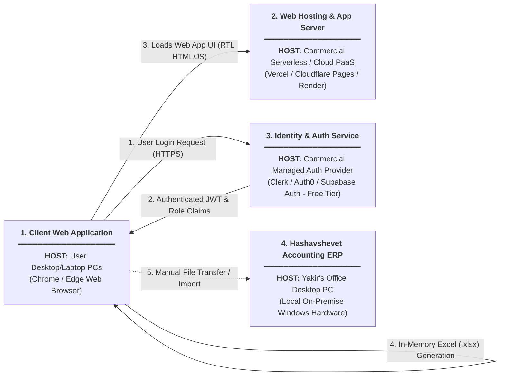
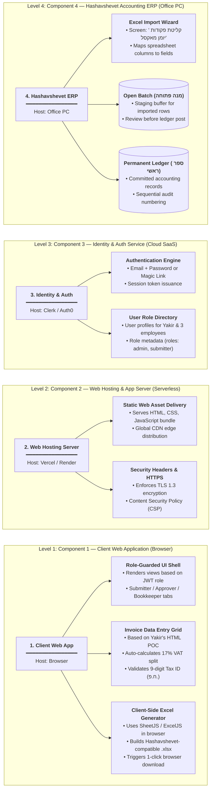

# System Architecture & Design: Version 2 (Simplified MVP)

## 1. Executive Summary & Radical Simplification

This document specifies the **Version 2 (Lean MVP)** architecture for Yakir's invoice automation assistant. 

Following Yakir's core operational reality and top priorities, the architecture removes all non-essential overhead:
1. **No Database (Stateless Architecture):** Yakir does not require cloud invoice storage, deduplication databases, or digital history tracking. He continues relying on physical paper binders for legal archive. The tool is a **pure data-transformation pipeline**: user inputs data $\rightarrow$ validates against Israeli tax rules $\rightarrow$ generates an Excel (`.xlsx` / `.xls`) batch file in memory $\rightarrow$ browser downloads it.
2. **No AI Vision / OCR Engine (Deferred to Roadmap):** Yakir already built a working HTML Proof-of-Concept (POC) where employees type invoice details into structured fields. In v1/v2, data entry remains manual/assisted by software calculation (VAT split, Luhn validation). Multimodal AI extraction is archived for future phases.
3. **Online Availability & Multi-Role Access Control (RBAC):** The tool is hosted on the public web so employees can access it anywhere. Every user must log in (authenticate), and the UI dynamically unlocks features based on their assigned role.
4. **Excel Export for Hashavshevet:** Generates standardized Excel files matching Hashavshevet's native spreadsheet import wizard (*קליטת פקודות יומן מאקסל*), loading directly into an Open Batch (*מנה פתוחה*).

---

## 2. High-Level Architecture & Hosting Platforms (Diagram 1)

*This diagram contains **no internal sub-blocks**. Each block represents an atomic system component and explicitly states its hosting platform.*

---

## 3. Inside Look into Components & Responsibilities (Diagram 2)

*This diagram contains **4 distinct horizontal levels**, corresponding directly to the components of Diagram 1. There are **no relations/edges between the big components** (as those are fully defined in Diagram 1). Each level branches Left-to-Right into its internal sub-components and duties.*

---

## 4. Why No Database is Needed (Stateless Philosophy)

In software architecture, introducing a database adds substantial maintenance: schema migrations, connection pooling, backup routines, security patches, and monthly hosting costs.

Yakir's operational constraints make a database redundant for Day-1:
- **Physical Paper is the Source of Truth:** Yakir and his team preserve all physical paper receipts in physical accordion files and lever-arch binders.
- **Hashavshevet is the System of Record:** Once an invoice is exported to Excel and imported into Hashavshevet, Hashavshevet's local Microsoft SQL Server becomes the permanent, legally audited store.
- **Ephemeral Session State:** While an employee is typing invoices during the workday, the rows exist in the browser's local memory (`React State` or `LocalStorage`). Once they click **"Generate Excel File"**, the batch is downloaded and fed to Hashavshevet.

---

## 5. Authentication & Access Control (RBAC) Without a Database

To manage user access without running a database server, we use a **Managed Authentication Provider** (such as **Clerk**, **Auth0**, or **Supabase Auth**) on their **free tier** (supporting up to 10,000 active monthly users):

### User Roles & Permissions Matrix

| Role | Target Users | Allowed Capabilities | Restricted Capabilities |
|---|---|---|---|
| **Submitter (מזין נתונים)** | Yossi & Field Staff | • Type new invoices into the grid. • Validate 17% VAT & Tax ID. • Save session drafts in browser. | ❌ Cannot export Excel for Hashavshevet. ❌ Cannot modify vendor chart of accounts. |
| **Approver / Manager (מנהל מאשר)** | Dan / Yakir | • View submitted entries. • Approve or reject individual expenses. | ❌ Cannot post directly to ledger. |
| **Bookkeeper / Admin (מנהל חשבונות)** | Sarah / Yakir | • Full access to review all entries. • Map Israeli Tax IDs to Supplier Account Cards (*כרטיסי ספק*). • **Download Hashavshevet Excel Batch File (*קובץ יבוא אקסל*)**. | Full administrative rights. |

### How Role Enforcement Works:
1. Yakir registers his 3 employees in the auth dashboard (takes 2 minutes).
2. Each user is assigned a role in their user metadata (`publicMetadata: { role: 'bookkeeper' }`).
3. When logging into the web app, the frontend decodes the signed JWT token:
   - If `role === 'submitter'`, the **"Export Excel"** button is hidden and disabled.
   - If `role === 'bookkeeper'`, all administrative and export features are unlocked.

---

## 6. Hashavshevet Excel Import Specification

Hashavshevet features a built-in Excel import wizard (*קליטת תנועות מאקסל*). The client-side app formats the exported spreadsheet to match Hashavshevet's expected columns:

### Target Excel Column Structure

| Column Letter | Hebrew Header | Field Purpose | Software / Business Rule | Example Value |
|:---:|---|---|---|:---:|
| **A** | **חובה** (Debit Account) | Expense Account Card (*חשבון הוצאה*) | 5-digit general ledger code | `40210` (כלי עבודה) |
| **B** | **זכות** (Credit Account) | Supplier Account Card (*כרטיס ספק*) | 5-digit supplier code in Hash' | `30082` (טכנו כלים בע"מ) |
| **C** | **תאריך אסמכתא** | Invoice Date | Date printed on tax invoice | `15/10/2026` |
| **D** | **תאריך ערך** | Value / Due Date | Payment due date | `15/10/2026` |
| **E** | **אסמכתא 1** | Invoice Number | Supplier's legal invoice # | `84920` |
| **F** | **סכום בש"ח** | Total Gross Amount | Total inclusive of 17% VAT | `1170.00` |
| **G** | **מע"מ** | VAT Amount (17%) | Input VAT (*מע"מ תשומות*) | `170.00` |
| **H** | **פרטים** | Transaction Details | Free-text description | `רכישת מקדחה ודיסק` |

### Import Workflow inside Hashavshevet:
1. Bookkeeper clicks **"Download Hashavshevet Excel"** in the web app.
2. Opens Hashavshevet Windows desktop UI $\rightarrow$ Menu: **הנהלת חשבונות** $\rightarrow$ **קליטת פקודות יומן מאקסל**.
3. Selects the downloaded `.xlsx` file.
4. Hashavshevet verifies balance ($\sum \text{Debit} == \sum \text{Credit}$) and places rows into an **Open Batch (*מנה פתוחה*)**.
5. Bookkeeper reviews the batch on screen and clicks **"קליטת מנה"** to commit to the permanent general ledger.

---

## 7. Cost & Asset Comparison (v1 vs. v2)

| Infrastructure Item | Version 1 (AI + Storage + DB) | Version 2 (Simplified MVP) |
|---|---|---|
| **Web & App Server** | Render / DigitalOcean (~$7 / mo) | **Vercel / Cloudflare Pages (Free Tier - 0 ₪)** |
| **Database** | Supabase Pro / Managed SQL (~$25 / mo) | **None (0 ₪)** |
| **File Storage** | Cloudflare R2 / S3 (~$5 / mo) | **None (0 ₪)** |
| **AI Vision & OCR** | OpenAI Vision API (~$10–$20 / mo) | **None (Deferred - 0 ₪)** |
| **User Authentication** | Custom Auth / Supabase Auth | **Clerk / Auth0 (Free Tier up to 10k users - 0 ₪)** |
| **Custom Domain (.co.il)** | ~70 ₪ / year (~6 ₪ / mo) | ~70 ₪ / year (~6 ₪ / mo) |
| **TOTAL RUNNING COST** | **~110 – 190 ₪ / month** | **~6 ₪ / month (virtually FREE)** |

---

## 8. Preserved Future Roadmap

The following advanced capabilities are safely preserved in our documentation archives (`docs/system_architecture_and_roadmap.md` and `docs/system_architecture_and_workflows.md`) for future expansion once Yakir validates the v2 MVP:
1. **Multimodal AI Vision & OCR Extraction:** Automatic scanning of PDF/image invoices with Hebrew field extraction.
2. **Cloud Document Archive & SHA-256 Deduplication:** Persistent database for searchable digital receipt history.
3. **Direct Movein / H-Connect Automation:** Direct API or batch synchronization bypassing manual Excel selection.
