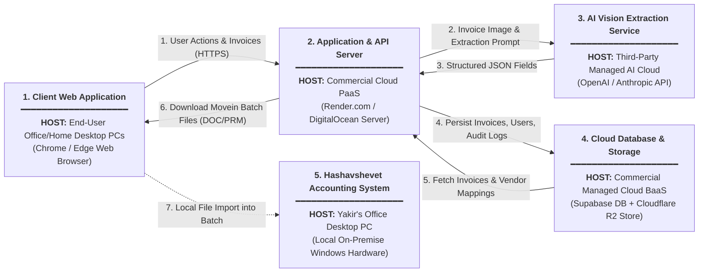
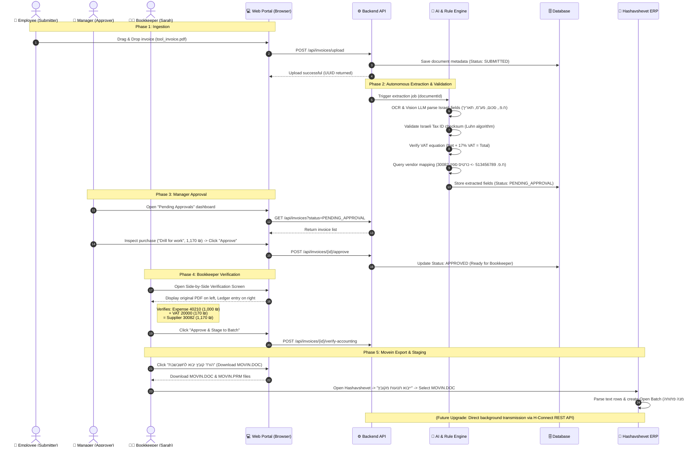

# System Architecture & Detailed Workflows (Web-Only)

---

## 1. Accounting Domain Foundations for the Developer

Before looking at the technical architecture, let's understand the core business concept in plain software engineering terms:

### What is a "Tax-Deductible Expense" (הוצאה מוכרת למס)?
- **Software Analogy:** Think of the company's taxable profit as `NetProfit = TotalRevenue - TaxDeductibleExpenses`.
- If Yakir earns 100,000 ₪ in revenue and buys a work drill for 1,000 ₪ (excluding VAT), that 1,000 ₪ is deducted from his taxable profit. Corporate income tax (*מס חברות*) is calculated on 99,000 ₪ instead of 100,000 ₪.
- **Rules of Recognition:** Under Israeli Income Tax Ordinance (*פקודת מס הכנסה, סעיף 17*), an expense is only deductible if incurred **solely and completely for producing business income**. Buying a power tool for client jobs qualifies; buying personal gifts does not.

### The VAT Separation Mechanism (הפרדת מע"מ תשומות):
When Yakir buys the tool for **1,170 ₪ total**:
1. **Net Expense (1,000 ₪):** Goes to Expense Account (*חשבון הוצאה מוכרת* `40210 - כלי עבודה`). Reduces company taxable profit.
2. **Input VAT (170 ₪ - מע"מ תשומות):** Goes to Asset Account (*מע"מ תשומות* `20000`). This is a **direct credit/rebate** from the government. At the end of the month, Yakir subtracts this 170 ₪ from the VAT he collected from his own customers.
3. **Supplier Debt (1,170 ₪):** Goes to Supplier Liability Account (*כרטיס ספק* `30082 - טכנו כלים בע"מ`). The company records that it owes 1,170 ₪ to the hardware store until paid.

---

## 2. System Architecture: Block Diagrams & Component Breakdown

To provide complete architectural clarity without vertical scrolling, the system architecture is structured into two horizontal Left-to-Right (`graph LR`) diagrams:
1. **Diagram 1: High-Level Architecture & Hosting Platforms** (No sub-blocks; purely high-level components explicitly declaring where they are hosted).
2. **Diagram 2: Inside Look into Components & Responsibilities** (Direct 1-to-1 breakdown of each component from Diagram 1 into its internal sub-components and duties).

---

### Diagram 1: High-Level Components & Hosting Platforms (Left to Right)

*This diagram contains **no internal sub-blocks**. Each block represents a major system component and explicitly states its hosting platform and physical/cloud environment.*

---

### Diagram 2: Inside Look into Components & Sub-Component Breakdown (Left to Right)

*This diagram contains **5 distinct levels**, one for each component from Diagram 1. There are **no relations/edges between the big components** (as those relationships are already defined in Diagram 1). Each level breaks down its parent component horizontally into its internal sub-components and responsibilities.*

```mermaid
graph LR
    %% Level 1: Client Web Application
    subgraph LEVEL_1 ["Level 1: Component 1 — Client Web Application (User Browser)"]
        direction LR
        C1_PARENT["<b>1. Client Web Application</b><br/>━━━━━━━━━━━━━━━━━━━━<br/>Host: User Desktop PCs"]
        C1_A["<b>Upload & Ingestion UI</b><br/>• Drag-and-drop PDF & images<br/>• Client-side format validation"]
        C1_B["<b>Manager Approval Portal</b><br/>• Single & bulk expense approvals<br/>• Rejection notes & status tracking"]
        C1_C["<b>Bookkeeper Review Studio</b><br/>• Split-screen PDF vs. extracted fields<br/>• 1-click Movein batch download"]
        C1_PARENT --> C1_A
        C1_PARENT --> C1_B
        C1_PARENT --> C1_C
    end

    %% Level 2: Application & API Server
    subgraph LEVEL_2 ["Level 2: Component 2 — Application & API Server (Commercial PaaS)"]
        direction LR
        C2_PARENT["<b>2. Application & API Server</b><br/>━━━━━━━━━━━━━━━━━━━━<br/>Host: Render / DigitalOcean"]
        C2_A["<b>API Gateway & RBAC</b><br/>• JWT authentication & session control<br/>• Role enforcement (Submit/Approve/Bookkeep)"]
        C2_B["<b>Async Task Queue & Worker</b><br/>• BullMQ / Redis background worker<br/>• High-DPI image conversion pipeline"]
        C2_C["<b>Israeli Rules & Checksum Engine</b><br/>• 9-digit Tax ID Luhn checksum<br/>• 17% VAT invariant checker (±0.05 ₪)<br/>• Balanced 3-line journal builder"]
        C2_D["<b>Movein File Generator</b><br/>• MOVIN.DOC & PRM formatter<br/>• Windows-1255 Hebrew encoding"]
        C2_PARENT --> C2_A
        C2_PARENT --> C2_B
        C2_PARENT --> C2_C
        C2_PARENT --> C2_D
    end

    %% Level 3: AI Vision Extraction Service
    subgraph LEVEL_3 ["Level 3: Component 3 — AI Vision Extraction Service (AI Cloud)"]
        direction LR
        C3_PARENT["<b>3. AI Vision Extraction Service</b><br/>━━━━━━━━━━━━━━━━━━━━<br/>Host: OpenAI / Claude API"]
        C3_A["<b>Multimodal Vision LLM</b><br/>• Hebrew prompt execution<br/>• Visual layout analysis of invoices"]
        C3_B["<b>Israeli Entity Parser</b><br/>• Tax ID, dates, total, VAT, אסמכתא<br/>• Allocation # (מספר הקצאה) extraction"]
        C3_C["<b>Confidence Evaluator</b><br/>• Field certainty scoring (0.0 - 1.0)<br/>• Review-flag generation for low clarity"]
        C3_PARENT --> C3_A
        C3_PARENT --> C3_B
        C3_PARENT --> C3_C
    end

    %% Level 4: Cloud Database & Storage
    subgraph LEVEL_4 ["Level 4: Component 4 — Cloud Database & Storage (Commercial BaaS)"]
        direction LR
        C4_PARENT["<b>4. Cloud Database & Storage</b><br/>━━━━━━━━━━━━━━━━━━━━<br/>Host: Supabase & Cloudflare R2"]
        C4_A[("<b>PostgreSQL Database</b><br/>• Users, roles, and invoice states<br/>• Vendor Tax ID -> Account mappings<br/>• Immutable audit trail & history")]
        C4_B[("<b>Encrypted Object Store</b><br/>• Original invoice PDFs & JPGs<br/>• High-DPI rendered page images")]
        C4_PARENT --> C4_A
        C4_PARENT --> C4_B
    end

    %% Level 5: Hashavshevet Accounting System
    subgraph LEVEL_5 ["Level 5: Component 5 — Hashavshevet Accounting System (Office PC)"]
        direction LR
        C5_PARENT["<b>5. Hashavshevet Accounting System</b><br/>━━━━━━━━━━━━━━━━━━━━<br/>Host: Yakir's Office Windows PC"]
        C5_A["<b>Win32 Desktop UI Wizard</b><br/>• Screen: 'קליטת פקודות יומן מקובץ'<br/>• Reads MOVIN.DOC & MOVIN.PRM"]
        C5_B[("<b>Open Batch (מנה פתוחה)</b><br/>• Staging buffer for imported rows<br/>• Edit & verify before posting")]
        C5_C[("<b>Permanent Ledger (ספר ראשי)</b><br/>• Committed accounting records<br/>• Irreversible sequential audit IDs")]
        C5_PARENT --> C5_A
        C5_PARENT --> C5_B
        C5_PARENT --> C5_C
    end
```

### Component Alignment & Traceability Matrix

| Component # in Diagram 1 | Component Name | Hosting Platform / Environment | Internal Sub-Components (Diagram 2) | Core Responsibilities |
|:---:|---|---|---|---|
| **1** | **Client Web Application** | **User Desktop PCs** (Chrome/Edge browser on office/home computers) | • Upload & Ingestion UI • Manager Approval Portal • Bookkeeper Review Studio | Presentation tier; handles user interactions, drag-and-drop file ingestion, visual verification, and downloading batch export files. |
| **2** | **Application & API Server** | **Commercial Cloud PaaS** (Render.com / DigitalOcean managed server) | • API Gateway & RBAC • Async Task Queue & Worker • Israeli Rules & Checksum Engine • Movein File Generator | Business logic tier; enforces authentication, manages async job pipeline, validates Israeli tax rules (Luhn/VAT), and generates Movein batch format. |
| **3** | **AI Vision Extraction Service** | **Third-Party AI Cloud** (OpenAI / Anthropic managed API) | • Multimodal Vision LLM • Israeli Entity Parser • Confidence Evaluator | Intelligence tier; reads invoice scans, extracts Hebrew tax entities, captures statutory allocation numbers, and scores OCR certainty. |
| **4** | **Cloud Database & Storage** | **Commercial Managed Cloud BaaS** (Supabase PostgreSQL + Cloudflare R2) | • Relational PostgreSQL DB • Encrypted Object Store | Data persistence tier; securely stores invoice PDFs/images, relational state machine records, vendor-to-account mappings, and audit trails. |
| **5** | **Hashavshevet Accounting System** | **Yakir's Office Desktop PC** (Local on-premise Windows workstation) | • Win32 Desktop UI Wizard • Open Batch (*מנה פתוחה*) • Permanent Ledger (*ספר ראשי*) | Core accounting ERP tier; receives Movein text files into staging buffer, allows manual check, and commits irreversible audit records to local SQL Server. |

---

## 3. Sequence Diagram: End-to-End Processing Flow

The following sequence illustrates the life cycle of an invoice from the moment an employee uploads it until it lands inside Hashavshevet in an open batch:

---

## 4. End-to-End User & System Workflow: Buying Work Tools (Step-by-Step)

Here is the exact human and machine trace for purchasing work tools and recording them as a recognized tax deduction:

### Scenario:
Yossi (field technician) purchases a heavy-duty rotary hammer drill and bits from **"טכנו כלים ואספקה טכנית בע\"מ"** (Techno Tools Ltd.) for **1,170.00 ₪** (1,000.00 ₪ net + 170.00 ₪ VAT).

---

### Step 1: Document Acquisition & Upload (Human - Submitter)
- **Actor:** Yossi (Role: `SUBMITTER`).
- **Action:**
  1. Yossi receives the digital Tax Invoice (*חשבונית מס מקור*) via email or saves the scanned PDF on his workstation computer.
  2. Yossi logs into the company web portal using his browser credentials.
  3. Navigates to the **"העלאת מסמכים" (Upload Documents)** tab.
  4. Drags and drops `techno_tools_inv_8841.pdf` into the upload zone and types an optional brief note: *"מקדחה רוטטת לעבודה בפרויקט גבעתיים"* (Rotary drill for Givatayim project).
  5. Clicks **"שלח לעיבוד" (Submit for Processing)**.

---

### Step 2: Ingestion & Task Queuing (Machine - Backend)
- **Actor:** Ingestion Service & Redis Job Queue.
- **Action:**
  1. Validates file integrity, MIME type (`application/pdf`), and file size (under 25MB).
  2. Generates cryptographic SHA-256 hash of the file to verify it hasn't been uploaded before (deduplication check).
  3. Uploads raw PDF to secure encrypted object storage (`/invoices/2026/10/techno_tools_inv_8841.pdf`).
  4. Creates record in database with state: `SUBMITTED`.
  5. Dispatches job `process-invoice-extraction` with payload `{ invoiceId: "INV-2026-10-091" }` to the worker queue.

---

### Step 3: AI Extraction & Israeli Tax Audit Checks (Machine - AI & Rule Engine)
- **Actor:** AI Extractor & Israeli Rules Engine.
- **Action:**
  1. Worker picks up job. Converts PDF page 1 into a high-DPI image render.
  2. Vision-Language Model processes Hebrew text, tables, and logos.
  3. **Extracted Metadata:**
     - **Supplier Name (*שם ספק*):** טכנו כלים ואספקה טכנית בע"מ
     - **Supplier Israeli Tax ID (*ח.פ. ספק*):** 513456789
     - **Invoice Number (*אסמכתא*):** 8841
     - **Invoice Date (*תאריך אסמכתא*):** 25/10/2026
     - **Payment Due Date (*תאריך ערך*):** 30/11/2026 (שוטף+30)
     - **Pre-VAT Net Amount (*סכום לפני מע"מ*):** 1,000.00 ₪
     - **VAT Amount (*סכום מע"מ 17%*):** 170.00 ₪
     - **Total Amount (*סכום כולל מע"מ*):** 1,170.00 ₪
     - **Allocation Number (*מספר הקצאה*):** None (Not required since total < 25,000 ₪).
  4. **Algorithmic Integrity Audits:**
     - Runs 9-digit Modulo-10 checksum on `513456789` -> **Valid**.
     - Calculates $1,000.00 \times 0.17 = 170.00$ ₪ -> **Valid** (Net + VAT == Total).
  5. Updates database state: `PENDING_APPROVAL`.

---

### Step 4: Operational & Commercial Approval (Human - Approver)
- **Actor:** Dan (Role: `APPROVER` - Operations / Purchasing Manager).
- **Action:**
  1. Dan logs into the web dashboard from his desktop browser.
  2. His dashboard displays a badge: **"3 חשבוניות ממתינות לאישור" (3 Invoices Pending Approval)**.
  3. Clicks on invoice `INV-2026-10-091`.
  4. Verifies the business legitimacy:
     - Confirms Yossi was authorized to purchase tools for the Givatayim project.
     - Confirms the total cost (1,170 ₪) matches the expected quotation.
  5. Clicks the green button **"אשר הוצאה" (Approve Expense)**.
  6. System transitions state: `APPROVED`.

---

### Step 5: Accounting Synthesis & Account Mapping (Machine - Accounting Engine)
- **Actor:** Accounting Rule Engine.
- **Action:**
  1. System checks the vendor directory: Does supplier `513456789` have an existing Account Key (*מפתח חשבון / כרטיס ספק*) in Hashavshevet?
     - Query matches: `30082` ("טכנו כלים בע\"מ").
  2. System evaluates default expense classification (*חשבון הוצאה*):
     - Line items describe "מקדחה ופטישון" (Drill and hammer).
     - Matched Category: `40210 - כלי עבודה ואחזקה` (Tools & Maintenance Expense).
  3. System creates a balanced 3-line **Journal Entry (פקודת יומן מאוזנת)**:
     - **Row 1:** Debit (*חובה*) Account `40210` (Tools Expense) = `1,000.00 ₪`
     - **Row 2:** Debit (*חובה*) Account `20000` (Input VAT 17%) = `170.00 ₪`
     - **Row 3:** Credit (*זכות*) Account `30082` (Supplier Debt) = `1,170.00 ₪`
     - **Balancing Check:** $\text{Debit (1,170.00)} = \text{Credit (1,170.00)}$. Invariant verified.
  4. Sets invoice status: `READY_FOR_BOOKKEEPER`.

---

### Step 6: Bookkeeper Verification & Staging (Human - Bookkeeper)
- **Actor:** Sarah (Role: `BOOKKEEPER` - Chief Bookkeeper).
- **Action:**
  1. Sarah opens the **"אימות הנהלת חשבונות" (Bookkeeping Verification)** screen.
  2. **Side-by-Side Review:**
     - Left pane: The original PDF invoice preview.
     - Right pane: Structured fields and the prepared Journal Entry lines.
  3. Sarah verifies:
     - Supplier tax ID matches the official printed receipt.
     - Expense account `40210` is accurate for work tools.
     - Tax invoice is marked "Original" (*מקור*).
  4. Clicks **"שבץ למנה פתוחה בחשבשבת" (Assign to Hashavshevet Open Batch)**.
  5. Status updates to `ACCOUNTING_VERIFIED`.

---

### Step 7: Export to Movein Batch Files & Open Batch Import (Human & Machine - Primary Integration)
- **Actor:** Hashavshevet Movein Engine & Sarah (Bookkeeper).
- **Action:**
  1. System generates standard Hashavshevet Movein format:
     - `MOVIN.DOC`: Formatted text rows containing transaction type `00`, reference `8841`, dates, accounts (`40210`, `20000`, `30082`), and balanced amounts.
     - `MOVIN.PRM`: Parameter mapping configuration.
  2. Sarah clicks **"הורד קובץ יבוא" (Download Import File)** on the web portal.
  3. Sarah switches to her Hashavshevet desktop window on the office PC:
     - Navigates to **הנהלת חשבונות -> פקודות יומן -> יבוא תנועות מקובץ (Movein)**.
     - Selects the downloaded `MOVIN.DOC`.
  4. Hashavshevet reads the file in 0.5 seconds, verifies balancing, and places the entry into an **Open Batch (מנה זמנית פתוחה # 1042)**.
  5. *(Future Roadmap Upgrade: Once Yakir purchases the H-Connect module from Hashavshevet, this step can happen fully automatically in the background via local HTTP REST API without the 1-click download).*

---

### Step 8: Final Review & Posting inside Hashavshevet (Human - CPA / Accountant)
- **Actor:** Sarah / Yakir's external CPA inside Hashavshevet desktop UI.
- **Action:**
  1. Opens Hashavshevet ERP -> "תנועות הנהלת חשבונות" -> "מנות פתוחות" (Open Batches).
  2. Selects `מנה 1042`.
  3. Sees the complete entry: 1,000 ₪ to tools expense, 170 ₪ to input VAT, and 1,170 ₪ to supplier.
  4. Clicks **"קליטת מנה" (Commit / Post Batch)**.
  5. The entry is now permanently recorded in the general ledger.
  6. The 1,000 ₪ officially reduces Yakir's annual taxable business profit, and the 170 ₪ is queued for the monthly VAT refund report (*דוח מע"מ PCN874*).
